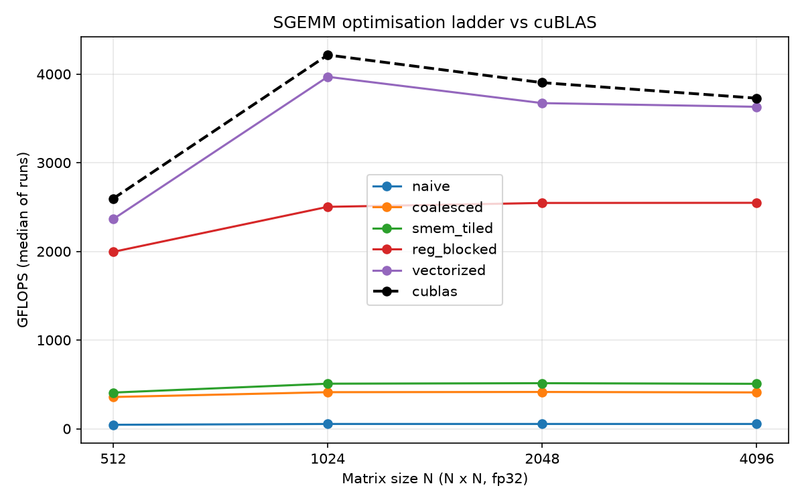
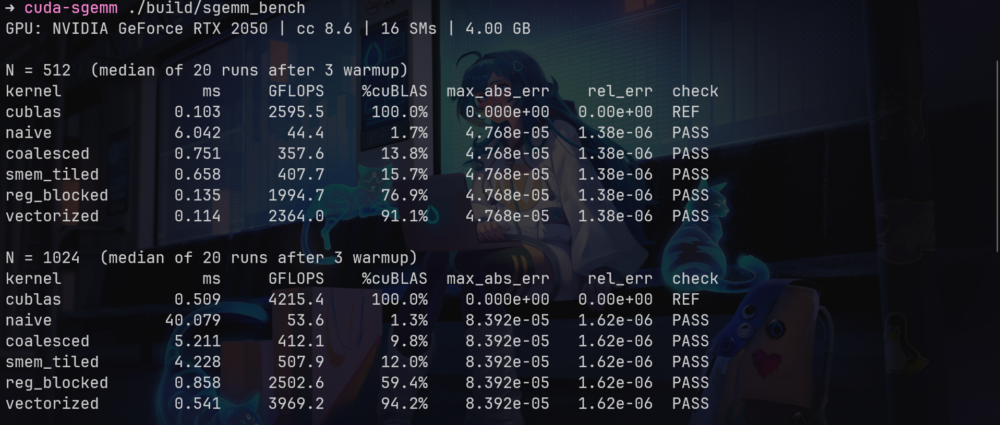
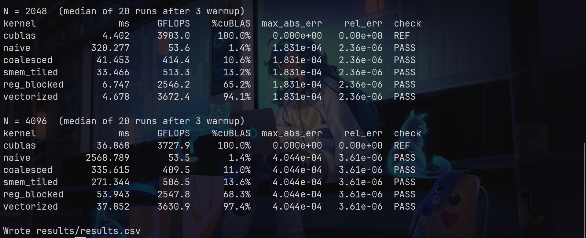

# CUDA SGEMM optimisation ladder (RTX 2050 / Ampere sm_86)

Five hand-written fp32 matrix-multiply kernels, `C = A * B` (square, row-major, N x N), each
one fixing the main bottleneck of the previous one, benchmarked against `cublasSgemm`.
All kernels are written from scratch for this repo. The *idea* of this ladder (naive -> coalesced
-> shared memory -> register blocking -> vectorisation) is inspired by Simon Boehm's article
["How to Optimize a CUDA Matmul Kernel for cuBLAS-like Performance"](https://siboehm.com/articles/22/CUDA-MMM).

| # | Kernel (`src/kernels/`) | Idea |
|---|---|---|
| 1 | `naive.cu` | one thread per C element, natural-but-uncoalesced index mapping |
| 2 | `coalesced.cu` | remap threads so a warp reads/writes consecutive addresses |
| 3 | `smem_tiled.cu` | 32x32 shared-memory tiles: each global value reused 32x |
| 4 | `reg_blocked.cu` | 128x128 block tile, BK=8, each thread computes an 8x8 register tile |
| 5 | `vectorized.cu` | kernel 4 + `float4` loads/stores, transposed + padded A tile in smem |

## Status

All five kernels pass verification against cuBLAS at every size.
Numbers are from a single full run; the sustained clock during the run was not recorded, so treat small-N
results (especially N=512, which differed by ~10% between two runs) as noisy.

## Build and run

```bash
nvidia-smi && nvcc --version     # sanity check your setup
make build                       # = cmake -S . -B build -DCMAKE_BUILD_TYPE=Release && cmake --build build -j
./build/sgemm_bench              # all kernels, N = 512,1024,2048,4096 -> prints tables, writes results/results.csv
python3 scripts/plot.py          # -> results/gflops.png
bash scripts/profile.sh          # Nsight Compute at N=2048 -> results/ncu/*.ncu-rep + results/ncu_summary.md
make emu-test                    # optional: CPU-only correctness check of all kernels' index math
```

`sgemm_bench` options: `--kernel all|naive|coalesced|smem_tiled|reg_blocked|vectorized`,
`--sizes 512,1024`, `--warmup 3`, `--iters 20`, `--csv path`. N must be a multiple of 128.

**Methodology.** Inputs: uniform random in [-1, 1], fixed seed. Reference: `cublasSgemm` with
`CUBLAS_DEFAULT_MATH` (strict fp32, no TF32), called with swapped operands to get row-major output.
Correctness: PASS if `max|C - C_ref| / max|C_ref| < 1e-4` (max abs and relative error are both
printed); C is pre-filled with NaN so unwritten elements fail. Timing: 3 warmup runs, then the
median of 20 runs, each timed with its own `cudaEvent` pair. GFLOPS = `2*N^3 / time`.

## Results (measured on RTX 2050)

Median of 20 runs after 3 warmups.
Max SM clock 2100 MHz (`nvidia-smi`), board power cap 50 W. At that clock the theoretical FP32 peak is 8602 GFLOPS (16 x 128 x 2 x 2.1 GHz); cuBLAS's best here (4215 GFLOPS) is ~49% of it and `vectorized`'s best (3969) ~46%. The sustained clock under the 50 W cap was not measured and is likely lower, so real efficiency is higher than these percentages.

GFLOPS (% of cuBLAS), from `results/results.csv`:

| Kernel | N=512 | N=1024 | N=2048 | N=4096 |
|---|---|---|---|---|
| naive | 44.4 (1.7%) | 53.6 (1.3%) | 53.6 (1.4%) | 53.5 (1.4%) |
| coalesced | 357.6 (13.8%) | 412.1 (9.8%) | 414.4 (10.6%) | 409.5 (11.0%) |
| smem_tiled | 407.7 (15.7%) | 507.9 (12.0%) | 513.3 (13.2%) | 506.5 (13.6%) |
| reg_blocked | 1994.7 (76.9%) | 2502.6 (59.4%) | 2546.2 (65.2%) | 2547.8 (68.3%) |
| vectorized | 2364.0 (91.1%) | 3969.2 (94.2%) | 3672.4 (94.1%) | 3630.9 (97.4%) |
| cuBLAS | 2595.5 | 4215.4 | 3903.0 | 3727.9 |

Correctness: all kernels PASS at all sizes. Max abs error grows with N from 4.8e-05 (N=512) to 4.0e-04
(N=4096); relative error (vs max |C_ref|) stays between 1.4e-06 and 3.6e-06, the same for every kernel.



Terminal output of the full benchmark run (N = 512, 1024 and N = 2048, 4096):




### Nsight Compute (N = 2048)

Measured with `scripts/profile.sh` (one launch per kernel).

| Kernel | Duration (ms) | DRAM % | L2 % | Occupancy % | Regs/thread | Smem conflicts ld | Smem conflicts st | Top stall (ratio) |
|---|---|---|---|---|---|---|---|---|
| naive | 384.5 | 2.7 | 1.9 | 65.7 | 40 | 0 | 0 | lg_throttle (197.8) |
| coalesced | 48.0 | 21.9 | 12.8 | 66.6 | 40 | 0 | 0 | lg_throttle (17.2) |
| smem_tiled | 39.2 | 26.4 | 15.7 | 66.6 | 38 | 0 | 2,629,164 | mio_throttle (23.6) |
| reg_blocked | 8.0 | 33.9 | 19.8 | 16.7 | 202 | 0 | 782,160 | none dominant (`selected` 1.00) |
| vectorized | 5.0 | 51.4 | 31.4 | 32.5 | 117 | 0 | 0 | none dominant (`not_selected` 2.02) |

ncu durations are longer than the benchmark's (e.g. naive 384 ms vs 320 ms): ncu normally locks GPU clocks
to a fixed base clock while profiling, which is the likely reason. Use the profile for *relative* comparisons.

## What limited each kernel

1. **naive (53.6 GFLOPS at N=2048)** — Not DRAM- or L2-bandwidth-bound (2.7% / 1.9%). The dominant stall by a wide
   margin is `lg_throttle` (197.8): the SM's queue for global-memory instructions is full. Each warp-wide A load
   likely splits into 32 separate requests, so the load/store path chokes long before the memory system does.
2. **coalesced (7.7x faster than naive)** — Identical arithmetic; only the index mapping changed. DRAM/L2 use rises
   (21.9% / 12.8%) because useful work now flows, and `lg_throttle` drops ~11x (17.2) but is still the top stall. Still
   limited by global-load traffic: every thread streams its operands with no block-level reuse.
3. **smem_tiled (+24% over coalesced)** — The top stall flips to `mio_throttle` (23.6): the shared-memory instruction
   queue, as expected for 1 FMA per 2 shared loads. Global traffic is no longer the issue (this is the first kernel where
   memory-queue stalls are shared-memory ones). *Unexpected:* ncu reports 2.6M shared-store bank conflicts; my
   index analysis predicts none for `As[ty][tx]`/`Bs[ty][tx]` stores.
4. **reg_blocked (65% of cuBLAS at N=2048)** — 202 registers/thread allows only one 256-thread block per SM (arithmetic: 202 regs
   rounds up to 208 x 256 threads = 53,248 of the SM's 65,536 registers), i.e. 8 warps = 16.7% occupancy, matching the
   measurement. No stall reason dominates, since the few warps are mostly issuing; with so few warps there is little to hide
   shared/global load latency or the barriers, and loads are scalar. *Unexpected:* 782k shared-store conflicts, also not explained by the index math.
5. **vectorized (94-97% of cuBLAS for N>=1024)** — 117 registers/thread -> 2 blocks/SM = 32.5% occupancy (measured), zero
   bank conflicts in loads and stores (the padded/transposed layout does what it was designed to), and fewer, wider memory
   instructions. Highest memory-system use of the five (DRAM 51.4%, L2 31.4%) but nowhere near saturated, and no stall
   dominates, so it is probably instruction-issue/compute-limited.

## Repository layout

```
src/sgemm.h             common kernel signature
src/kernels/*.cu        the five kernels (one file each, each with its launcher)
src/main.cu             harness: random data, cuBLAS reference, verification, timing, CSV
scripts/profile.sh      Nsight Compute driver      scripts/ncu_summary.py  report -> markdown
scripts/plot.py         results.csv -> gflops.png
tests/                  CPU emulation test (no GPU needed) for the kernels' index math
docs/                   terminal screenshots of the benchmark run
results/                results.csv, gflops.png, ncu/*.ncu-rep[z] (generated)
```
